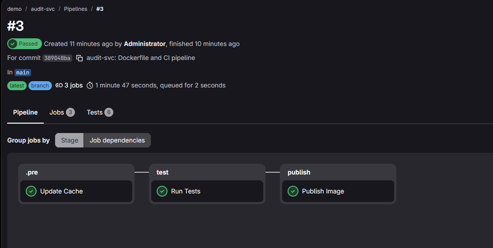
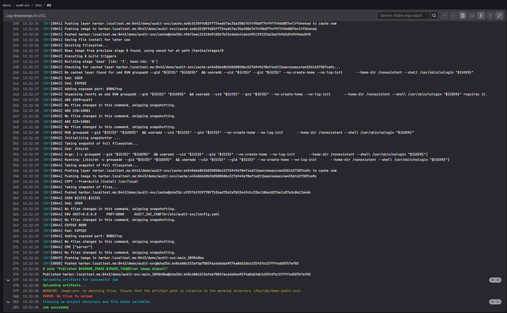
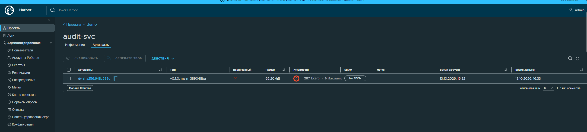
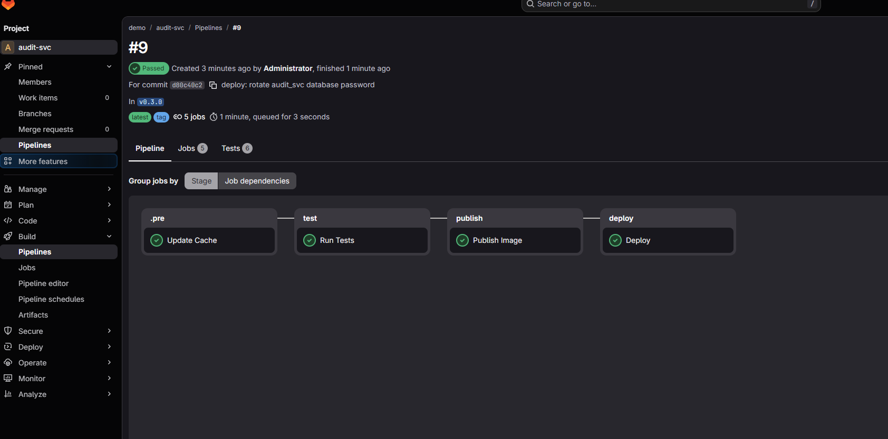
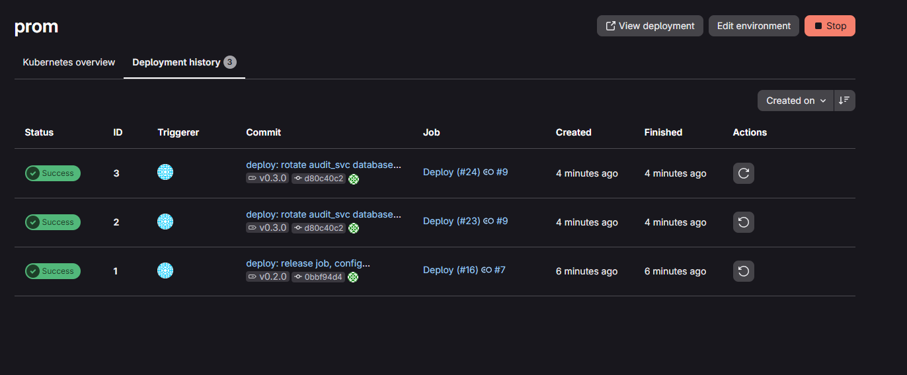
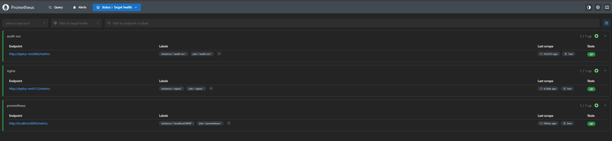
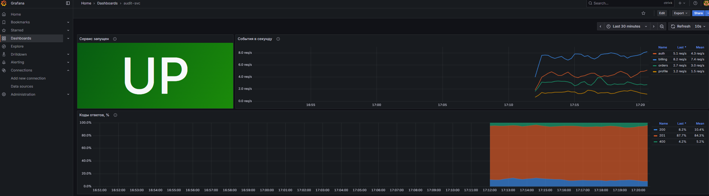
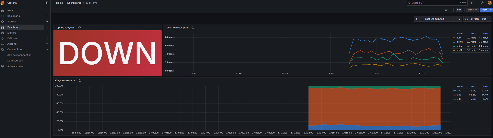
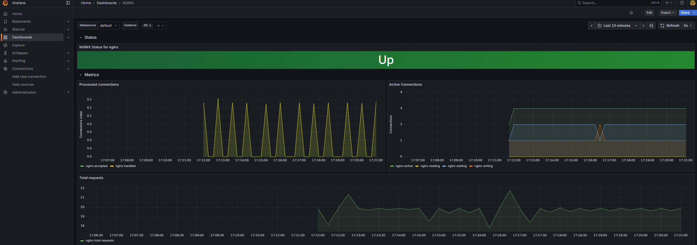

# Итоговая работа: развёртывание и мониторинг audit-svc

Делал по варианту 1: стенд лекции 4.

| Что | Где |
|-----|-----|
| Сервис | `src/`, `tests/`, `pyproject.toml`, `poetry.lock` |
| Образ | `Dockerfile`, `.dockerignore` |
| Пайплайн | `.gitlab-ci.yml` |
| Развёртывание | `deploy/`: плейбук `audit-svc.play.yml`, шаблоны `config.yaml.j2` и `nginx.conf.j2`, зашифрованный `vault.yml` |
| Мониторинг | `monitoring/`: Prometheus, Grafana, дашборды `grafana/audit-svc.json` и `grafana/nginx.json` |
| Скриншоты и логи | `screenshots/` |

Релизы, о которых идёт речь ниже:

| Тег | Что в нём | Пайплайн |
|-----|-----------|----------|
| `v0.1.0` | первая публикация образа, задачи развёртывания ещё нет | #4 |
| `v0.2.0` | задача развёртывания, конфиг из шаблона, хендлер reload | #7 |
| `v0.3.0` | смена пароля `audit_svc` для проверки задания 3 | #9 |
| `v0.4.0` | Nginx и nginx-exporter | #11 |
| `v0.5.0` | миграция `0003_events_actor_index`| #13 |

## 1. Сборка и публикация образа

В `Dockerfile` три стадии. `base` берёт `python:3.11-slim-bookworm`, закреплённый по digest. В `build` Poetry 1.8 собирает колёса зависимостей и самого сервиса и ставит их в префикс `/install`. `final` копирует `/install` в `/usr/local`, так что `server`, `migrate` и `generate` оказываются в `/usr/local/bin`, и запускает процесс от пользователя `audit` (uid и gid 10001).

```console
$ docker run --rm --entrypoint sh audit-svc:local -c 'id; migrate --help | head -1; generate --help | head -1'
uid=10001(audit) gid=10001(audit) groups=10001(audit)
usage: migrate [-h] [--config CONFIG]
usage: generate [-h] [--url URL] [--rate RATE] [--duration DURATION]
```

`.dockerignore` пропускает в контекст только `pyproject.toml`, `poetry.lock`, `README.md` и `src/`. Правки в `deploy/`, `monitoring/` и `.gitlab-ci.yml` образ не меняют.

Из шаблонов `demo/templates` подключил переменные, правила и заготовки задач Poetry и Kaniko (`variables/main.yml`, `rules/main.yml`, `jobs/poetry.yml`, `jobs/kaniko.yml`). Готовый `pipelines/python_poetry_docker.yml` брать не стал: его `Deploy Job` коммитит в `counter-deploy`, а `Build Package` не нужен, раз образ собирается из исходников.

| Задача | Ветка `main` | Тег `vX.Y.Z` |
|--------|--------------|--------------|
| `Update Cache` | да | да |
| `Run Tests`: `poetry run pytest --junitxml`, отчёт JUnit | да | да |
| `Publish Image`: Kaniko, публикация в Harbor | `main_<короткий sha>` | `vX.Y.Z` |
| `Deploy` | нет | да, см. задание 3 |

Учётка робота Harbor приходит из переменных группы `HARBOR_ROBOT_USER` и `HARBOR_ROBOT_SECRET` (masked, protected). В `.gitlab-ci.yml` её нет, в логе `Publish Image` секрета тоже нет.

Пайплайн ветки по умолчанию, #3, тесты 6 из 6:




```text
INFO[0049] Pushing image to harbor.localtest.me:8443/demo/audit-svc:main_389048ba
INFO[0050] Pushed harbor.localtest.me:8443/demo/audit-svc@sha256:648c688c523afda7003fac6debba9574a8d63db1d25fd7e157fffed507b7ef03
Published harbor.localtest.me:8443/demo/audit-svc:main_389048ba@sha256:648c688c523afda7003fac6debba9574a8d63db1d25fd7e157fffed507b7ef03
```



В Harbor `v0.1.0` и `main_389048ba` записаны как один артефакт



## 2. База данных и секреты

PostgreSQL запущен контейнером `postgres:17` с данными в именованном томе `audit-pg-data`, в сети `audit`. Порт я не публиковал совсем, даже на `127.0.0.1`.

БД и пользователя создают задачи `community.postgresql.postgresql_user` и `postgresql_db`.

```console
$ docker exec deploy-vm docker exec postgres psql -U postgres -Atc "SELECT datname, pg_get_userbyid(datdba) FROM pg_database WHERE datname='audit'"
audit|audit_svc
```

Пароль суперпользователя и пароль `audit_svc` лежат в `deploy/inventories/prom/group_vars/all/vault.yml`, зашифрованном `ansible-vault` (`$ANSIBLE_VAULT;1.1;AES256`). В `main.yml` рядом только ссылки на эти переменные, а у задач с паролями стоит `no_log: true`.

Ключ от vault хранится в переменной проекта `ANSIBLE_VAULT_PASSWORD` с флагами Masked и Protected. Ansible получает его через `--vault-password-file ./vault-pass.sh`


## 3. Развёртывание из CI

Задача `Deploy` запускается только на защищённом теге `vX.Y.Z` после `Publish Image`. Её выполняет деплой-раннер на `deploy-vm` (`tags: [deploy, prom]`), который берёт только защищённые ссылки. Окружение `prom`, URL `http://localhost:8088`.

```bash
ansible-playbook audit-svc.play.yml --vault-password-file ./vault-pass.sh \
  --extra-vars "audit_svc_image=$HARBOR_IMAGE:$CI_COMMIT_TAG"
```





Конфиг пишет модуль `template` в `/data/audit-svc/config/config.yaml` с правами `0640`, владелец файла `gitlab-runner`. Раннер не может отдать файл root, поэтому процесс в контейнере (uid 10001) получает дополнительную группу раннера через параметр `groups` и читает файл по групповому праву.

```console
$ docker exec deploy-vm ls -ln /data/audit-svc/config/
-rw-r----- 1 999 998 137 Oct 13 13:51 config.yaml
$ docker exec deploy-vm docker exec audit-svc id
uid=10001(audit) gid=10001(audit) groups=10001(audit),998
```

В контейнер смонтирован каталог, а не сам файл. `template` записывает новый файл и переименовывает его поверх старого, inode меняется, и bind-mount одного файла продолжал бы показывать старую версию.

### Проверка смены пароля, релиз `v0.3.0`

1. Время старта контейнера и счётчик до релиза:

   ```console
   $ docker exec deploy-vm docker inspect -f '{{.State.StartedAt}}' audit-svc
   2026-10-13T13:51:27.61579257Z
   audit_config_reloads_total{result="success"} 1.0
   ```

2. Поменял пароль `audit_svc` через `ansible-vault edit`, закоммитил (`d80c40c2 deploy: rotate audit_svc database password`) и создал тег `v0.3.0`.
3. Лог развёртывания, полностью в [screenshots/deploy_password_change.log](screenshots/deploy_password_change.log):

   ```text
   TASK [Create database user audit_svc] ******************************************
   changed: [deploy-vm]
   TASK [Render audit-svc config] *************************************************
   changed: [deploy-vm]
   TASK [Apply database migrations] ***********************************************
   ok: [deploy-vm]
   TASK [Start audit-svc container] ***********************************************
   ok: [deploy-vm]
   RUNNING HANDLER [Reload audit-svc config] **************************************
   ok: [deploy-vm]
   TASK [Check audit-svc health] **************************************************
   ok: [deploy-vm]
   PLAY RECAP *********************************************************************
   deploy-vm                  : ok=16   changed=2    unreachable=0    failed=0    skipped=0    rescued=0    ignored=0
   ```

4. После релиза:

   ```console
   $ docker exec deploy-vm docker inspect -f '{{.State.StartedAt}}' audit-svc
   2026-10-13T13:51:27.61579257Z                       # не изменился
   $ docker exec deploy-vm docker logs audit-svc 2>&1 | grep 'config reloaded' | tail -1
   2026-10-13 13:55:08,014 [INFO] audit_svc.main: config reloaded, reconnected to the database
   audit_config_reloads_total{result="success"} 2.0    # был 1.0
   healthz: 200
   ```

### Идемпотентность

Повторный запуск той же задачи кнопкой Retry (job 24) дал `changed=0`, хендлер не сработал. Полный лог в [screenshots/deploy_rerun_changed0.log](screenshots/deploy_rerun_changed0.log):

```text
TASK [Render audit-svc config] *************************************************
ok: [deploy-vm]
TASK [Start audit-svc container] ***********************************************
ok: [deploy-vm]
TASK [Flush handlers] **********************************************************
TASK [Check audit-svc health] **************************************************
ok: [deploy-vm]
PLAY RECAP *********************************************************************
deploy-vm                  : ok=15   changed=0    unreachable=0    failed=0    skipped=0    rescued=0    ignored=0
```

В сохранённых логах у задачи `Start audit-svc container` есть `DEPRECATION WARNING` про `image_name_mismatch`. Позже я задал этот параметр в плейбуке явно, и предупреждение пропало.

## 4. Nginx и nginx-exporter

Порт наружу публикуют только `nginx` (`8080`, на хосте это `localhost:8088`) и `nginx-exporter` (`9113`). `audit-svc` и `postgres` сидят в сети `audit` без `ports`.

`/reload` закрыт локацией `location ~* ^/reload { return 404; }`. Nginx сравнивает локации с уже нормализованным URI: аргументы отброшены, `%XX` раскодированы, `//` склеены, `/./` и `/../` разобраны. Поэтому все варианты обхода попадают в эту локацию и до сервиса не доходят.

`stub_status` вынесен на отдельный порт `8081`, который не публикуется. Exporter читает `http://nginx:8081/stub_status`, а на основном порту `/stub_status` отвечает 404.

В `proxy_pass` адрес подставляется через переменную, а рядом задан `resolver 127.0.0.11`, так что имя `audit-svc` резолвится на каждый запрос. Без этого Nginx после пересоздания контейнера сервиса ходил бы на старый IP и отвечал 502.

```console
$ curl -s localhost:8088/healthz
{"status": "ok"}
$ curl -s -o /dev/null -w '%{http_code}\n' -X POST localhost:8088/reload
404
$ curl -s -o /dev/null -w '%{http_code}\n' -X POST 'localhost:8088/reload?x=1'
404
$ curl -s -o /dev/null -w '%{http_code}\n' -X POST localhost:8088//reload
404
$ curl -s -o /dev/null -w '%{http_code}\n' -X POST localhost:8088/%72eload
404
$ docker exec deploy-vm docker logs audit-svc 2>&1 | grep -c 'config reload'   # и до, и после запросов
0
$ docker exec deploy-vm docker ps --format '{{.Names}}\t{{.Ports}}'
audit-generate  8080/tcp          # временный генератор нагрузки из задания 5
audit-svc       8080/tcp
nginx-exporter  0.0.0.0:9113->9113/tcp
nginx           80/tcp, 0.0.0.0:8080->8080/tcp
postgres        5432/tcp
```

`8080/tcp`, `80/tcp` и `5432/tcp` без стрелки объявлены в образах через `EXPOSE`, наружу они не опубликованы. Ещё я проверил `/RELOAD`, `/reload/`, `/./reload`, `/api/../reload` и `/%2Freload`, везде 404.

```console
$ docker run --rm --network lab curlimages/curl:8.11.1 -s deploy-vm:9113/metrics | grep '^nginx_up'
nginx_up 1
$ docker run --rm --network lab curlimages/curl:8.11.1 -s -o /dev/null -w '%{http_code}\n' deploy-vm:8080/stub_status
404
```

## 5. Мониторинг

`monitoring/compose.yaml` взят из ДЗ 3 без Node Exporter. Prometheus и Grafana подключены к сети стенда `lab` (`external: true`). Имя проекта `audit-monitoring`, чтобы не задеть тома ДЗ 3. Источник данных и оба дашборда Grafana подключает из файлов репозитория через provisioning.

| job | цель | что это |
|-----|------|---------|
| `audit-svc` | `deploy-vm:8080/metrics` | метрики сервиса через Nginx |
| `nginx` | `deploy-vm:9113` | nginx-prometheus-exporter |



Нагрузку давал 15 минут в сети развёртывания:

```bash
docker exec deploy-vm docker run -d --rm --name audit-generate --network audit \
  harbor.localtest.me:8443/demo/audit-svc:v0.5.0 generate --url http://nginx:8080 --duration 900
```

Дашборд сервиса я собрал сам, он лежит в `monitoring/grafana/audit-svc.json`:

| Панель | Запрос |
|--------|--------|
| События в секунду | `sum by (app) (rate(audit_events_received_total{job="audit-svc"}[$__rate_interval]))`, по линии на приложение |
| Коды ответов, % | `100 * sum by (code) (rate(audit_http_requests_total{job="audit-svc"}[$__rate_interval])) / scalar(sum(rate(audit_http_requests_total{job="audit-svc"}[$__rate_interval])))`, слои с накоплением, в сумме 100 % |
| Сервис запущен | Stat по `up{job="audit-svc"}`: `1` показывает `UP` зелёным, `0` показывает `DOWN` красным |

Цвета приложений и кодов ответа заданы по имени ряда, поэтому не зависят от порядка рядов на графике.



Потом остановил сервис командой `docker exec deploy-vm docker stop audit-svc`. Nginx стал отвечать Prometheus `502 Bad Gateway`, и `up` упал в 0:



После `docker start audit-svc` панель вернулась в `UP`, `/healthz` через Nginx снова отвечает 200.

Дашборд Nginx (`monitoring/grafana/nginx.json`) взят из [репозитория nginx-prometheus-exporter](https://github.com/nginxinc/nginx-prometheus-exporter/tree/main/grafana) без изменений. Источник данных он выбирает своей переменной `DS_PROMETHEUS`.



## Доп. задание: миграции при каждом развёртывании

В плейбуке задача `Apply database migrations` стоит перед `Start audit-svc container`. Она запускает `migrate` из нового образа отдельным контейнером (`detach: false`, `cleanup: true`) с тем же конфигом и в той же сети.

Если `migrate` завершится с ошибкой, `docker_container` вернёт `FAILED`, плейбук остановится, и новый образ не запустится. Я проверил это на контейнере, который выходит с кодом 3: `FAILED! => {"msg": "migration failed\n", "status": 3}`. Статус `changed` задача получает только когда в выводе есть `applying`. При неизменной схеме она остаётся `ok` с выводом `done: 0 applied, 2 already in place`, это видно во всех логах выше.

Для проверки добавил миграцию `src/audit_svc/migrations/0003_events_actor_index.sql` с индексом по `actor` и выпустил `v0.5.0`. Полный лог в [screenshots/deploy_migration_0003.log](screenshots/deploy_migration_0003.log):

```text
TASK [Apply database migrations] ***********************************************
changed: [deploy-vm]
TASK [Show migration log] ******************************************************
ok: [deploy-vm] => {
    "msg": [
        "[INFO] applying 0003_events_actor_index",
        "[INFO] done: 1 applied, 2 already in place"
    ]
}
TASK [Start audit-svc container] ***********************************************
changed: [deploy-vm]
...
PLAY RECAP *********************************************************************
deploy-vm                  : ok=19   changed=2    unreachable=0    failed=0    skipped=0    rescued=0    ignored=0
```

Здесь поменялся код, так что образ впервые получился другим, и контейнер пересоздан с `v0.5.0`. `/healthz` через Nginx после этого отвечает 200.

```console
$ docker exec deploy-vm docker exec postgres psql -U postgres -d audit -Atc "SELECT version FROM schema_migrations ORDER BY 1"
0001_create_events
0002_events_app_index
0003_events_actor_index
```
